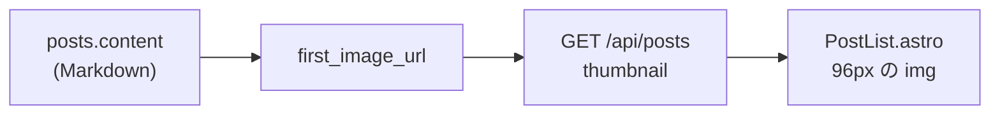

# 構成と仕様

```
.
├── backend/    Workers の API（Rust / workers-rs）
│   ├── migrations/0001_init.sql
│   └── src/lib.rs  util.rs
├── frontend/   Astro（SSR）。Worker + 静的ファイルとしてデプロイ
└── tools/      取り込み、画像移行、投稿 CLI（TypeScript）
```

ブラウザはフロントの Worker にアクセスし、フロントが API の Worker を `fetch()` して D1 の記事を描画します。

## データ

`backend/migrations/0001_init.sql` が正です。

- `posts`: `slug`（一意）、`title`、`content`（Markdown）、`excerpt`、`status`（`draft` / `published`）、`published_at`、`created_at`、`updated_at`、`legacy_url`
- `categories`、`post_categories`: カテゴリと、記事との多対多
- 時刻はすべて UTC の ISO 8601（`2019-11-22T18:13:44Z`）で持ちます。文字列のまま並べ替えられます。表示のときだけ JST にします。

## URL と slug

記事の URL は `/entry/<slug>` です。`slug` の形は `YYYY/MM/DD/HHMMSS`（JST の公開日時）で、はてなブログの記事パスと同じです。同時刻の記事には `_1` のような接尾辞が付きます。省略して投稿すると `published_at` から作られます。使える文字は英数字と `-` `_` `/` です。

| パス | 内容 |
|---|---|
| `/`、`/page/N` | 新しい順の一覧（20 件ずつ） |
| `/entry/<slug>` | 記事 |
| `/category`、`/category/<名前>?page=N` | カテゴリ一覧、カテゴリの記事 |
| `/rss.xml` | 最新 20 件の RSS |

応答には `Cache-Control: public, max-age=60, s-maxage=600` を付けます。

## 本文の表示

`frontend/src/lib/render.ts` が Markdown を HTML にして、許可リスト方式でサニタイズします。

- Markdown は `marked`（GFM、改行を `<br>` にする）で変換します。
- `script`、`on*` 属性、`javascript:` は落とします。
- `iframe` は `www.youtube.com`、`www.youtube-nocookie.com`、`embed.music.apple.com` だけ許可します。
- 外部リンクには `rel="noopener noreferrer"`、画像には `loading="lazy"` を付けます。
- 本文に `<!-- toc -->` があれば、`h2` / `h3` の目次に置き換えます。見出しには `h-1` のような id が付きます。
- `<a class="link-card">` はブログカードとして表示します。

## 一覧の抜粋

`excerpt` は書き込み時に作ります（HTML タグと Markdown の記号を除いた先頭 120 文字）。規則は `backend/src/util.rs` の `make_excerpt` と `tools/text.ts` の `makeExcerpt` で同じです。

一覧のサムネイルは保存せず、読み出しのたびに `content` から求めます。`backend/src/util.rs` の `first_image_url` が本文の最初の画像の URL を返し、一覧 API が `thumbnail` として返し、`PostList.astro` が表示します。画像の無い記事は `null` で、一覧の見た目は変わりません。



`first_image_url` の規則は次のとおりです。

- Markdown の `` と HTML の `` を対象にし、先頭に近いほうを採ります。
- バッククォート 3 つで囲んだコードブロックの中は飛ばします。
- URL は `http://`、`https://`、`/` 始まりのパスだけ通します。`javascript:`、`data:`、`//host`、相対パスは捨てて、次の画像を探します。
- Markdown の URL の前後の空白と、後ろの `"title"` は落とします。

一覧 API は `content` を読んでから捨てるので、応答には含みません。画像の URL は書き換えず、そのまま `src` に入れます。RSS には反映しません。
