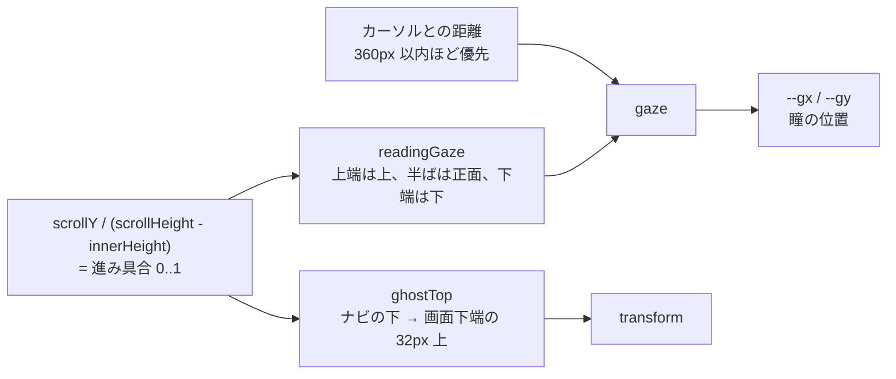
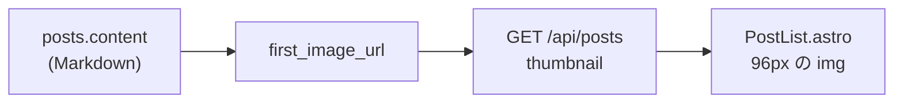

# 構成と仕様

```
.
├── backend/    Workers の API（Rust / workers-rs）
│   ├── migrations/0001_init.sql
│   └── src/lib.rs  util.rs
├── frontend/   Astro（SSR）。Worker + 静的ファイルとしてデプロイ
└── tools/      取り込み、画像移行、投稿 CLI（TypeScript）
```

ブラウザはフロントの Worker にアクセスし、フロントが API の Worker を `fetch()` して D1 の記事を描画します。

## データ

`backend/migrations/0001_init.sql` が正です。

- `posts`: `slug`（一意）、`title`、`content`（Markdown）、`excerpt`、`status`（`draft` / `published`）、`published_at`、`created_at`、`updated_at`、`legacy_url`
- `categories`、`post_categories`: カテゴリと、記事との多対多
- 時刻はすべて UTC の ISO 8601（`2019-11-22T18:13:44Z`）で持ちます。文字列のまま並べ替えられます。表示のときだけ JST にします。

## URL と slug

記事の URL は `/entry/<slug>` です。`slug` の形は `YYYY/MM/DD/HHMMSS`（JST の公開日時）で、はてなブログの記事パスと同じです。同時刻の記事には `_1` のような接尾辞が付きます。省略して投稿すると `published_at` から作られます。使える文字は英数字と `-` `_` `/` です。

| パス | 内容 |
|---|---|
| `/`、`/page/N` | 新しい順の一覧（20 件ずつ） |
| `/entry/<slug>` | 記事 |
| `/category`、`/category/<名前>?page=N` | カテゴリ一覧、カテゴリの記事 |
| `/rss.xml` | 最新 20 件の RSS |

応答には `Cache-Control: public, max-age=60, s-maxage=600` を付けます。

## 本文の表示

`frontend/src/lib/render.ts` が Markdown を HTML にして、許可リスト方式でサニタイズします。

- Markdown は `marked`（GFM、改行を `<br>` にする）で変換します。
- `script`、`on*` 属性、`javascript:` は落とします。
- `iframe` は `www.youtube.com`、`www.youtube-nocookie.com`、`embed.music.apple.com` だけ許可します。
- 外部リンクには `rel="noopener noreferrer"`、画像には `loading="lazy"` を付けます。
- 本文に `<!-- toc -->` があれば、`h2` / `h3` の目次に置き換えます。見出しには `h-1` のような id が付きます。
- `<a class="link-card">` はブログカードとして表示します。

## 見た目

色、フォント、角丸と影を持たない形は共有パッケージ `@asuforce/tintwork` のトークンに従い、テーマはダークとライトです。本文（`.post-body`）の読みやすさを最優先にし、装飾は本文に重ねません。表示の言語は日本語のままです。

- テーマ: `Layout.astro` の inline script が、`localStorage` の `theme`、OS の設定、ダークの順に決めて `<html data-theme>` に付けます。ナビ右端のボタンで切り替えると `localStorage` に残し、`theme-color` も更新します。
- 星: 固定乱数の 190 個を、画面に固定した canvas に描きます。数、大きさ、明るさは official と同じで、テーマが変わると `--star` と `--star-a` で色を引き直します。ライトでは黒、不透明度は 0.55 倍です。`main`、ヘッダー、フッターは星より前面です。
- ゴースト: 画面幅が 1000px 以上のときだけ、本文の列の右の余白の中央に幅 72px で固定表示します。1000px 未満はヘッダーのサイト名の左に 28px の静止した姿を置き、どちらか一方だけを出します。位置と瞳の向きはスクロールの進み具合で決め、どこにも着地しません。動きを減らす設定では、漂いと位置の追従を止めます。
- 見出し: ヘッダーのサイト名、h1、ページ送り、日付、タグのラベルは、大文字の D-DIN（太さ 700）で字間を持たせます。本文の見出しは大文字にしません。



計算は `frontend/src/lib/world.ts` の純粋な関数で、`frontend/test/world.test.ts` が検証します。DOM に触る部分は `frontend/src/scripts/world.ts` です。ページが画面に収まるときは進み具合が 0 のままで、ゴーストは上の位置に留まります。

## 一覧の抜粋

`excerpt` は書き込み時に作ります（HTML タグと Markdown の記号を除いた先頭 120 文字）。規則は `backend/src/util.rs` の `make_excerpt` と `tools/text.ts` の `makeExcerpt` で同じです。

一覧のサムネイルは保存せず、読み出しのたびに `content` から求めます。`backend/src/util.rs` の `first_image_url` が本文の最初の画像の URL を返し、一覧 API が `thumbnail` として返し、`PostList.astro` が表示します。画像の無い記事は `null` で、一覧の見た目は変わりません。



`first_image_url` の規則は次のとおりです。

- 本文を `pulldown-cmark` で CommonMark として読み、記事ページの描画で最初に現れる画像を採ります。インラインコード、コードブロック（バッククォート、チルダ、4 つ字下げ）、`\!` で打ち消した画像は画像になりません。対応する `](` のない `` と参照形式を対象にし、URL の括弧は対になっていれば URL に含めます。
- HTML の `` は、生の HTML の断片からだけ読みます。HTML コメントの中は飛ばし、引用符の中の `>` ではタグを閉じず、`data-src` や他の属性の値は `src` と見なしません。
- Markdown の画像と HTML の `` は、本文に現れる順に調べます。
- URL は `http://`、`https://`、`/` 始まりのパスだけ通します。ページが `img` の `src` として描画する種類に合わせた規則で、`javascript:`、`data:`、`//host`、相対パスは捨てて、次の画像を探します。空白と制御文字を含む URL も捨てます。ブラウザは URL の改行や tab を取り除くので、`/` + 改行 + `/host` が `//host` になるためです。

一覧 API は `content` を読んでから捨てるので、応答には含みません。画像の URL は、Markdown のエスケープと HTML の `&amp;` を戻す以外は書き換えず、そのまま `src` に入れます。RSS には反映しません。
