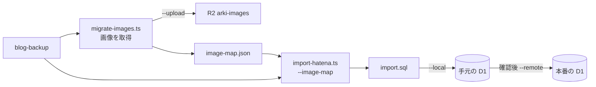

# はてなブログの取り込み

`blogsync pull` で取得したバックアップ（`entry/YYYY/MM/DD/HHMMSS.md`）を D1 に入れます。記事はリポジトリに含めません。

## 全体の流れ

画像を先に R2 へ移しておくと、本番への取り込みは 1 回で済みます。先に本文だけ取り込んでも、あとから画像の URL を置き換えて入れ直せます。



## 手順

```bash
cd tools && npm install
npx tsx import-hatena.ts <backup-dir>/<your>.hatenablog.com \
  --old-host <your>.hatenablog.com --out ./import.sql
cd ../backend
npx wrangler d1 migrations apply arki-db --local                      # 初回だけ。テーブルを作る
npx wrangler d1 execute arki-db --local  --file=../tools/import.sql   # まず手元で確認
npx wrangler d1 execute arki-db --remote --file=../tools/import.sql
```

本番にもテーブルが要ります。まだなら `migrations apply arki-db --remote` を先に実行してください（[setup.md](setup.md)）。

`import.sql` は記事を含むので `.gitignore` 済みです。コミットしないでください。何度流しても、取り込んだ記事（`legacy_url` が入っているもの）だけが入れ替わり、`arki-post` で書いた記事には触りません。

流したあとは件数を確かめます。`--local` でも `--remote` でも同じ SQL です。

```bash
npx wrangler d1 execute arki-db --remote --command \
  "SELECT status, count(*) FROM posts GROUP BY status"
```

バックアップの記事数と `published`・`draft` の合計が一致し、`legacy_url IS NULL` の記事が `arki-post` で書いた数と同じなら取り込めています。

## 対応

| はてな | D1 |
|---|---|
| ファイルのパス | `slug`（`_1` 付きもそのまま） |
| `Title` | `title` |
| `Date`（`+09:00`） | `published_at`（UTC に変換） |
| `Draft: true` | `status = 'draft'`、それ以外は `published` |
| `Category` | `categories` と `post_categories` |
| `URL` | `legacy_url` |
| `EditURL` | 使わない |

パスと `Date` が食い違う記事は、取り込み時に件数を知らせます（記事の日付をあとから直した場合に起きます）。`slug` はパスのままなので、旧 URL は変わりません。

## 記法の変換

`tools/hatena.ts` が本文を変換します。コードブロックの中は変換しません。

| 入力 | 出力 |
|---|---|
| `[f:id:user:20200531145634j:plain]` | ``（`j`→jpg、`p`→png、`g`→gif） |
| フォトライフの `<span ...></span>` | `` |
| `[URL:embed:cite]` | `<a href="URL" class="link-card">` |
| `[URL:embed]`、`[URL:embed#コメント]`（Twitter など） | コメントを引用にして、URL へのリンク |
| `[URL:title]`、`[URL:title=テキスト]` | `[テキストか URL](URL)` |
| `[asin:ID:detail]` | `[Amazon](https://www.amazon.co.jp/dp/ID)` |
| `[:contents]` | `<!-- toc -->` |
| `<!-- more -->` | 削除 |
| はてなブログカードの `<iframe>` | 普通のリンク |
| `--old-host` の記事へのリンク | `/entry/...` の相対パス |

変換できずに残った記法は、取り込みの最後に一覧で表示します。YouTube などの `iframe` はそのまま残します（表示側で許可したホストだけ描画されます）。

## 画像の移行

そのままでも、画像ははてなの CDN から表示されます。はてなブログを閉じる前に、R2 へ移してください。

```bash
cd tools
npx tsx migrate-images.ts <backup-dir>/<your>.hatenablog.com \
  --base-url https://<R2 の公開 URL> --bucket <bucket 名> --upload
```

- 画像を `tools/out/images/` に取得し、`--upload` を付けると `wrangler r2 object put` で R2 の `legacy/fotolife/...` に置きます。付けなければ取得だけです。
- 実行すると `tools/image-map.json`（はてなの URL → 新しい URL）ができます。
- `import-hatena.ts` を `--image-map ./image-map.json` 付きでもう一度流すと、本文の画像 URL が置き換わります。
- はてなへの負荷を抑えるため、取得は 0.5 秒おきです。取得済みの画像は飛ばすので、途中で止まっても同じコマンドで続きから進みます。
- `--base-url` は、バケットに割り当てたカスタムドメインです。`r2.dev` の公開 URL は無効のままで構いません。`--upload` なしで流すと `image-map.json` に仮の URL を入れられますが、本番の URL が決まったら `--upload` 付きで流し直してください。
- `--upload` は画像 1 枚ごとに `wrangler` を起動するので、938 枚で数十分かかります。

### 費用

R2 は、保管が月 10GB、書き込みが月 100 万回、読み取りが月 1000 万回まで無料で、外向きの転送量は課金されません。938 枚・約 480MB の移行では、無料枠の中に収まりました。ただし R2 を有効にするには、アカウントに支払い方法の登録が要ることがあります。

### 確認

アップロード後、`image-map.json` の URL を何枚か `curl` で開き、200 が返ってサイズが手元の `tools/out/images/` と同じことを確かめてから、`--image-map` 付きで取り込み直します。本番の D1 は取り込みのたびに記事が入れ替わるので、先に `--local` で、はてなの画像 URL が残っていないかを見ます。

```bash
npx wrangler d1 execute arki-db --local --command \
  "SELECT count(*) FROM posts WHERE content LIKE '%cdn-ak.f.st-hatena.com%'"   # 0 になる
```
