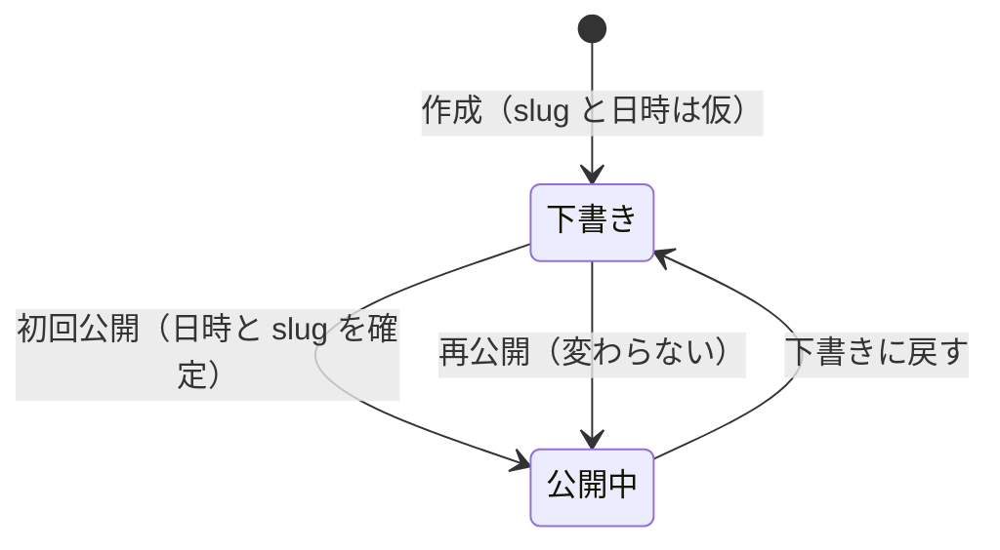

# 記事を投稿する

投稿は管理画面（`/admin`）で行います。PC でもスマホでも使えます。Markdown ファイルを送る CLI（`arki-post`）は廃止しました。

## 入り方

`https://<ブログの URL>/admin` を開くと、Cloudflare Access の Google ログインが出ます。許可したメールアドレスだけが入れます。ログイン済みの端末では、公開ページのヘッダーに「Admin」のリンクが出ます。設定は [deploy.md](deploy.md#管理画面の設定) にあります。

## 画面

- 一覧（`/admin`）: 状態タブ（すべて、下書き、公開中）、題名の検索、ページ送りがあります。下書きが先に並びます。各行から公開と下書きの切り替え、削除ができます。削除は確認のあとに実際に消し、公開中の記事でも消せます。
- 新規作成（`/admin/new`）と編集（`/admin/edit/<id>`）: 題名、カテゴリ、公開日時、slug、本文を入れます。PC は本文とプレビューを左右に並べ、スマホは「書く」と「プレビュー」のタブで切り替えます。プレビューは公開側と同じ `render.ts` で作ります。
- カテゴリは既存の名前から選ぶか、新しい名前を入れて Enter で足します。
- 画像は本文へ貼り付けるかドロップします。「画像を追加」からも選べます。AVIF に変換した URL が本文に入ります（[api.md](api.md#画像のアップロード)）。

## 保存

保存は手動です。「保存」か Ctrl+S（Mac は Cmd+S）で行います。未保存の入力は、手を止めて 0.4 秒後にその端末の `localStorage` へ退避します。閉じたあとに開き直すと戻せます。

別の端末で先に保存されていた場合は、書き込まずに最新を読み直して知らせます。自分の編集は退避してあり、「自分の版に戻す」で戻せます（[api.md](api.md#更新の競合)）。

## 公開日時と slug

- 下書きの間の slug は仮の値です。初回公開の瞬間に、公開日時から作り直して固定します（同じ slug があれば `_1`、`_2`）。
- 公開日時を空にしたまま公開すると、公開の瞬間になります。入れておけば、その日時で公開します。
- 公開後の編集画面では slug は読み取り専用です。「変更する」にチェックを入れたときだけ変えられます。URL が変わるので、公開済みの記事では注意してください。
- 下書きに戻して再公開しても、slug と公開日時は変わりません。
- はてなから取り込んだ記事は、元の日時と slug のままです。
