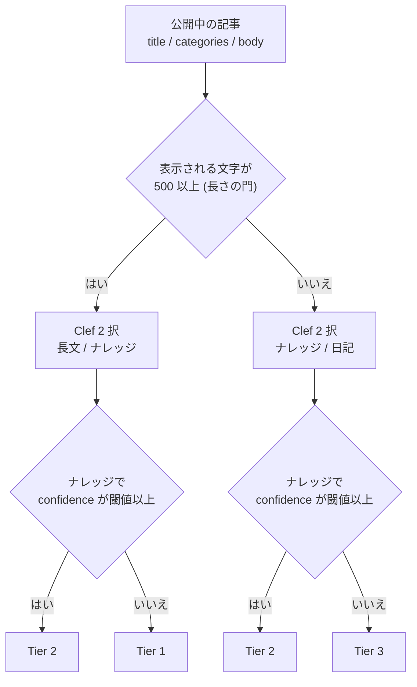
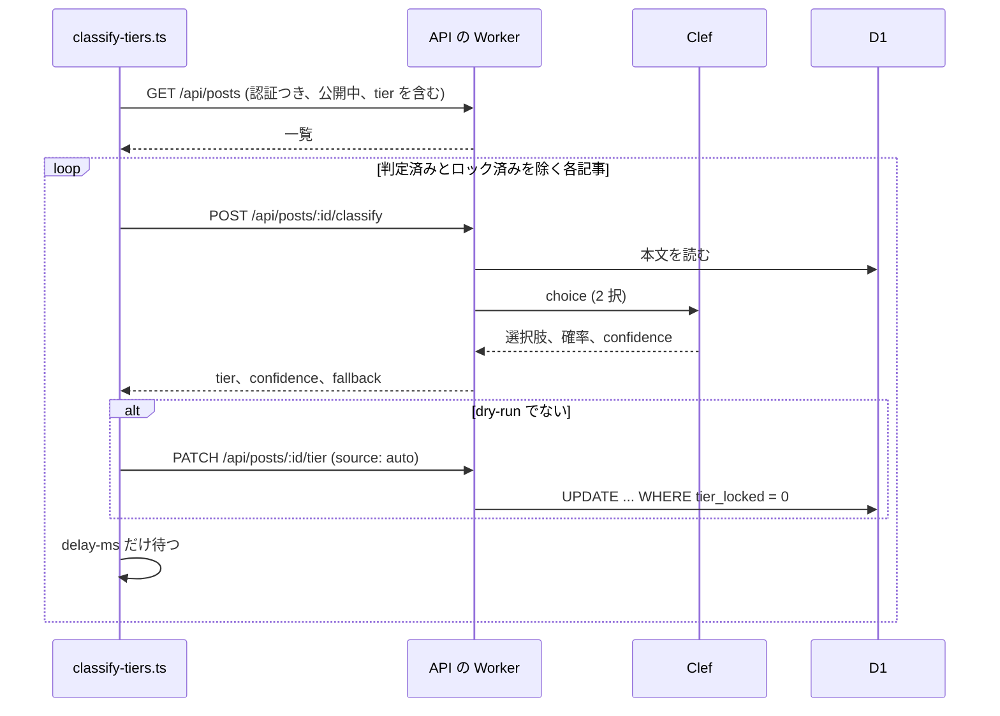

# 記事のティア判定

状態: 実装済み。Clef の呼び出しと、本番の D1 への migration、デプロイ、一括判定は未実施です。API の使い方は [api.md](api.md#ティア) にあります。用語は [CONTEXT.md](../CONTEXT.md) にあります。

記事に、長文（Tier 1）、ナレッジ（Tier 2）、日記（Tier 3）のいずれかを付けます。判定には Cloudflare の Clef を使います。まずは既存の公開中の記事を一括で判定する仕組みを作り、新規記事の自動判定は別の作業にします。tier の使い道はまだ決めていません。保存して見られるところまでを範囲とします。

## 決めたこと

| 項目 | 決定 |
|---|---|
| 保存先 | D1 の `posts` に列を足す。記事に Frontmatter は無い |
| 判定モデル | Clef 系（Workers AI）。初期値は `@cf/cloudflare/clef-flash` で、較正の標本で `@cf/cloudflare/clef` と比べて決める。モデル名は設定値にする。Jev と request の形が同じなので、後で入れ替えられる |
| 呼び出し | API の Worker が Workers AI の binding で Clef を呼ぶ。ツールは `ADMIN_TOKEN` だけを持つ |
| 一括処理 | `tools/classify-tiers.ts`（TypeScript）。Rust は migration、判定、tier の読み書きだけ |
| 公開 API | tier は認証つきの応答にだけ出す。公開の一覧、記事、RSS には出さない |
| 入力 | タイトル、カテゴリ、本文 |
| 判定の対象 | 公開中の記事。下書きは含めない |
| 長さの門 | 表示される文字で 500 文字（初期値。較正で調整する） |

## 長さの数え方

門は、読者に見える文字の数で決めます。生の Markdown の長さでは、リンクカードや画像の URL で短い記事が水増しされるためです。

- 単位は Unicode のコードポイントです（Rust の `chars().count()`）。`str::len()` はバイト数で、日本語が約 3 倍に数えられるので使いません。
- 数える前に、次を除きます。HTML コメント、コードブロックの囲みの行、ブログカードの行、HTML タグ、画像の記法、リンクの URL（文字は残す）、本文中の裸の URL、Markdown の記号（`#` `*` `` ` `` `>` `|`）、空白と改行。
- コードブロックの中身は数えます。技術記事の長さを削らないためです。
- 除く規則は `backend/src/tier.rs` の `visible_length` にあります。`make_excerpt` は使いません。裸の `<`（`if a < b`、`x<3`）以降を次の `>` まで消し、`vec![` を画像の記法と読むためです。フェンスの内側の行は記号もタグもそのまま数え、外側は `<` の直後が英字、`/`、`!` のときだけタグとみなします。HTML コメントの除去も、フェンスの外に限ります。

標本の実測では、この数え方で 500 文字以上の記事が 162 件（9%）あります。生の長さで 1000 文字以上だった 161 件と、規模がほぼ同じです。

## 判定のしくみ



規則は 1 行です。ナレッジは、Clef がナレッジを選び、confidence が閾値以上のときだけ付けます。それ以外は、分岐のもう一方（門を超えた記事は長文、超えない記事は日記）にします。

- 長さは数えられるので、コードで決めます。門を超えた記事は日記を選べず、超えない記事は長文を選べません。「長いのに日記と判定される」誤りが、構造的に起きません。
- 質問はいつも 2 択で、閾値が効くのはナレッジのときだけです。長文や日記が最多のときは、confidence が低くても、行き先は変わりません。
- どの記事にも tier が入ります。
- 門を超えた雑記（ご飯とゲームだけの長いログ）も、長文になります。長さを主軸にした結果で、承知のうえです。
- `tier_confidence` には、Clef が返した `confidence` をそのまま保存します。

### 選択肢の説明文

Clef の `choice` は、選択肢のキーに説明文を付けて渡します。次は初期案で、較正で調整します。

| 分岐 | キー | 説明文 |
|---|---|---|
| 門を超えた | `long` | 考察、検証、設計の考え、体験を、自分の言葉で掘り下げている |
| 門を超えた | `knowledge` | 再利用できる手順や設定を、まとめて記録している |
| 超えない | `knowledge` | 再利用できる手順、設定、エラーの解決、学びがある |
| 超えない | `diary` | 感想や出来事が中心で、再利用できる知見がない |

```text
POST (Workers AI)  @cf/cloudflare/clef
{
  model: "clef",
  state: "<title>\n<categories>\n\n<body>",
  questions: {
    tier: {
      type: "choice",
      instructions: "<記事の性格を選ぶ>",
      criteria: { <分岐ごとのキーと説明文> }
    }
  }
}
```

## データ

`backend/migrations/0003_tier.sql` を足します。既存の行は、すべて `tier` が NULL、`tier_locked` が 0 です。

```sql
ALTER TABLE posts ADD COLUMN tier INTEGER CHECK (tier IN (1, 2, 3));
ALTER TABLE posts ADD COLUMN tier_confidence REAL CHECK (tier_confidence BETWEEN 0 AND 1);
ALTER TABLE posts ADD COLUMN tier_locked INTEGER NOT NULL DEFAULT 0;
```

| 列 | 意味 |
|---|---|
| `tier` | 1、2、3。NULL は未判定 |
| `tier_confidence` | Clef が返した `confidence`。人が決めた行は NULL |
| `tier_locked` | 1 のとき、自動の判定は書き込まない |

## API

どれも `ADMIN_TOKEN` が要ります。本文と `updated_at` には触れません。管理画面の更新の競合検出（[api.md](api.md#更新の競合)）を、誤って起こさないためです。

| メソッド | パス | 内容 |
|---|---|---|
| POST | `/api/posts/:id/classify` | 判定だけをして、書き込まない |
| PATCH | `/api/posts/:id/tier` | tier を書く |

`classify` の応答は次の形です。`fallback` は、Clef の最多の選択肢と最終の tier が違うときだけ true です。

```json
{
  "tier": 3,
  "confidence": 0.58,
  "fallback": true,
  "gate": "short",
  "length": 212,
  "probabilities": { "knowledge": 0.54, "diary": 0.46 }
}
```

`PATCH` は 3 通りの書き方があります。

| 本文 | 意味 | 結果 |
|---|---|---|
| `{ "tier": 2 }` | 人が決めた | `tier_confidence` を NULL にして、`tier_locked` を 1 にする |
| `{ "tier": 2, "tier_confidence": 0.91, "source": "auto" }` | バッチが決めた | `tier_locked = 0` の行にだけ書く。ロック済みなら 409 |
| `{ "tier_locked": false }` | ロックを外す | tier と `tier_confidence` はそのまま |

ロックの確認と書き込みは、1 つの条件つき `UPDATE` で行います。確認から書き込みの間にロックが付いても、上書きしません。

ロックを外した記事は、tier が残っているので判定済みのままです。通常の実行では飛ばされます。判定し直すときは `--force` を付けます。

認証つきの `GET /api/posts` と `GET /api/posts/:id` の応答に、`tier`、`tier_confidence`、`tier_locked` を足します。認証なしの応答には出しません。管理画面で tier を触る画面は、今回は作りません。

## 一括判定のツール

`tools/classify-tiers.ts` です。既存の `import-hatena.ts` などと同じく、API を `ADMIN_TOKEN` で呼びます。

```text
npx tsx classify-tiers.ts --api-url <URL> [--dry-run] [--force] [--delay-ms 500] [--limit N]
```



- 対象は公開中の記事です。`tier` が入っている行（判定済み）と、`tier_locked` が 1 の行は飛ばします。途中で止まっても、同じ引数で続きから再開できます。
- `--force` は判定済みをやり直します。ロックは `--force` でも破りません。
- `--dry-run` は `classify` だけを呼び、`PATCH` を送りません。1 行 1 記事で、id、slug、長さ、分岐、tier、confidence、フォールバックの有無を出し、最後に tier ごとの件数とフォールバックの件数を出します。
- 429 と 5xx は、間隔を広げて 3 回まで再試行します。それでも失敗した記事は、記事ごとにエラーを出して次へ進み、最後に件数で報告します。
- 1 回の `classify` は Clef を 1 回だけ呼ぶので、Worker の subrequest の上限には当たりません。

## 変更の範囲

```diff
 backend/
 ├── migrations/
+│   └── 0003_tier.sql
 └── src/
+    ├── tier.rs           # 長さの数え方、長さの門、選択肢、ナレッジの規則
+    ├── clef.rs           # Workers AI の呼び出しと応答の読み取り
     └── lib.rs            # classify と PATCH、認証つきの応答に tier を足す
 tools/
+├── classify-tiers.ts
+└── test/classify-tiers.test.ts
 docs/
+└── tier-scoring.md
```

`backend/wrangler.toml.example` に、Workers AI の binding（`[ai]`）を足します。

## 較正

閾値の 0.65 と選択肢の説明文は、根拠のある値ではありません。あなたが tier を付けた標本で確かめてから、一括判定を本番に流します。

- 標本は無作為ではなく、層ごとに抜きます。無作為に 40 件だと、長文が 4 件ほどしか入らないためです。
  - 門を超えた記事を 15 件。日次テンプレート（TL;DR、感想、ご飯）、技術記事、長い個人の記事を混ぜる。
  - 超えない記事を 25 件。技術のメモ、ゲームの記録、食べ物、旅行、参加録を混ぜる。
- 標本に `--dry-run` を通し、あなたの tier と突き合わせます。
- 見る値は、分岐ごとの「ナレッジの適合率」です。閾値はナレッジを付けるかどうかだけを動かすので、この 1 つで決まります。
  - 長文の分岐では、ナレッジと判定された記事のうち、あなたもナレッジとした割合。避けたい誤りは「長い記事が低く見られること」なので、ここでは適合率を厳しく見る。
  - 短い記事の分岐では、同じ割合に加えて、あなたがナレッジとした記事が日記に落ちた数も見る。
- 閾値は分岐ごとに決めます。2 つの分岐は選択肢の組が違い、`confidence` の尺度も同じとは限りません。
- 同じ標本を `clef-flash` と `clef` の両方に通し、ナレッジの適合率で選びます。差が小さければ、安くて速い `clef-flash` にします。
- 500 文字の門、閾値、説明文、モデルを変えたら、同じ標本でやり直します。合格基準の数値は、標本を見てからあなたが決めます。

## 費用と無料枠

Workers AI は、Free と Paid のどちらでも 1 日 10,000 Neurons が無料です。UTC の 0 時（日本時間 9 時）にリセットされ、Free では超えるとエラーになります。ほかの Workers AI の利用分も同じ枠から引かれます。

| モデル | 入力料金 | 文脈長 | Neuron |
|---|---|---|---|
| `clef-flash`（9B） | 100 万トークンあたり $0.038 | 24K | 100 万トークンあたり 3,455 |
| `clef`（27B） | 100 万トークンあたり $0.24 | 64K | 約 21,800（料金からの換算） |

1831 件の判定に要る入力は、説明文を含めて 100 万トークン前後と見ています（推定）。`clef-flash` なら約 3,500 Neurons で、1 日の無料枠に収まります。`clef` は約 22,000 Neurons で、2〜3 日に分ければ無料、一度に流しても約 $0.26 です。実際の消費は、標本を通したときに Workers AI のダッシュボードで確かめます。`--limit` と、判定済みを飛ばす再開の仕組みがあるので、無料枠に合わせて日をまたいで流せます。

## 本番の記事の実測

2026-10-13 に公開 API から 1831 件を読み、上の数え方に沿って数えました。

| 項目 | 結果 |
|---|---|
| 表示される文字数 | 中央値 107、90 パーセンタイル 442、最長 3326。100 文字未満が 852 件 |
| 門ごとの候補 | 300 文字で 317 件、500 文字で 162 件、600 文字で 131 件、1000 文字で 54 件 |
| 500 文字以上の内訳 | tech 48、game 32、personal 33 |
| カテゴリ（全体） | personal 762、game 504、food 186、tech 84、travel 67 |
| h2、コードブロックのある記事 | どちらも 12 件 |

生の長さと比べると、リンクカードや画像の多い短い記事が減ります。例えば「SW JFO をプレイ」は生で 1047 文字でしたが、表示される文字は 348 です。

門を超える 162 件が長文かナレッジになり、残りの約 1670 件がナレッジか日記になります。日記が大半になる見込みです。

## 確かめること

実装で確かめたのは、長さの数え方だけです。2026-10-15 に本番の公開 API から 1831 件を読み、`backend/src/tier.rs` の `visible_length` で数えると、100 文字未満が 852 件、300 文字以上が 317 件、500 文字以上が 162 件、600 文字以上が 131 件、1000 文字以上が 54 件でした。「SW JFO をプレイ」は 348 です。上の実測と一致します。

残りは、公式のドキュメントで確認できておらず、実際に 1 回呼んで確かめる必要があります。呼び出しと応答の読み取りは `backend/src/clef.rs` の `build_request` と `read_answer` に閉じてあり、`confidence` と `probabilities` の場所は推測です。読めないときは、API が応答の全体をログに出して 422 を返します。再試行しても同じ結果になるため、ツールは 422 を再試行しません。

- 応答で、確率と `confidence` が入るフィールドの名前。`answers.<key>.choice` だけがドキュメントにある。
- `confidence` の定義。二次情報では、選んだ選択肢の確率ではなく、確率分布の集中度とされている。
- 入力が長いときの扱い。公式の表は文脈長を `clef` が 64K、`clef-flash` が 24K トークンとしているが、二次情報には Workers AI が約 2K トークンで切り捨てるという報告もある。最長の記事は表示される文字で 3326 なので影響は小さいが、長文の分岐で確かめる。
- `rejectIfBusy` の扱い。
- workers-rs 0.8 で Workers AI の binding を呼べること。呼べなければ、`js_sys` で `env.AI.run` を呼ぶ。

## 見送ったこと

- 新規記事の公開時に自動で判定する処理。`classify` の実装を使い回せる。
- 管理画面での tier の表示、選択、ロックの切り替え。
- tier による一覧や RSS の絞り込み。
- 判定の履歴、モデル名の記録。モデルを替えたときは `--force` で全件を判定し直す。
